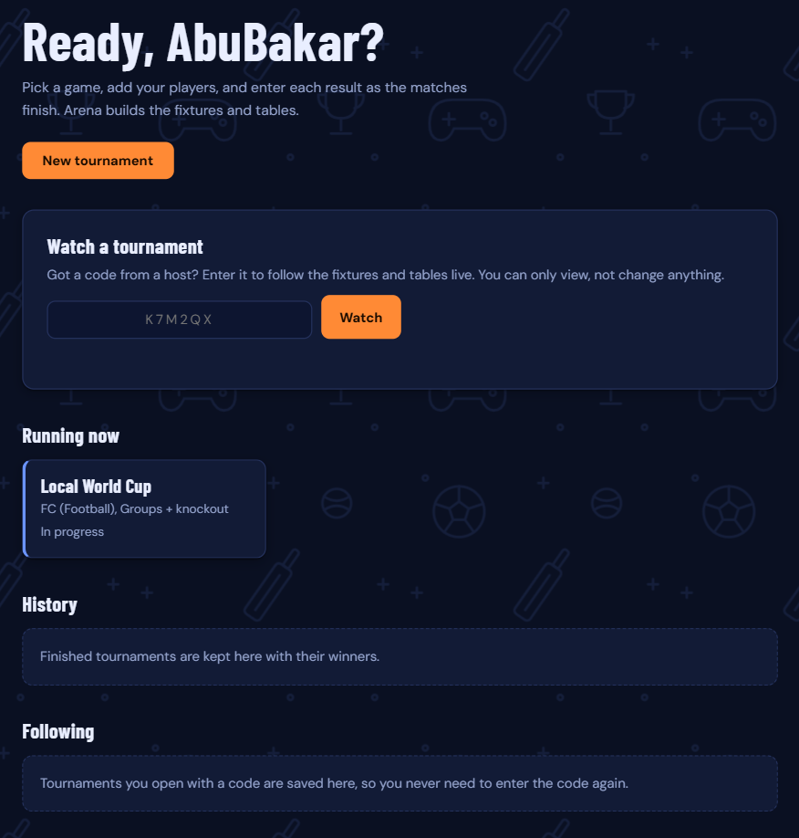
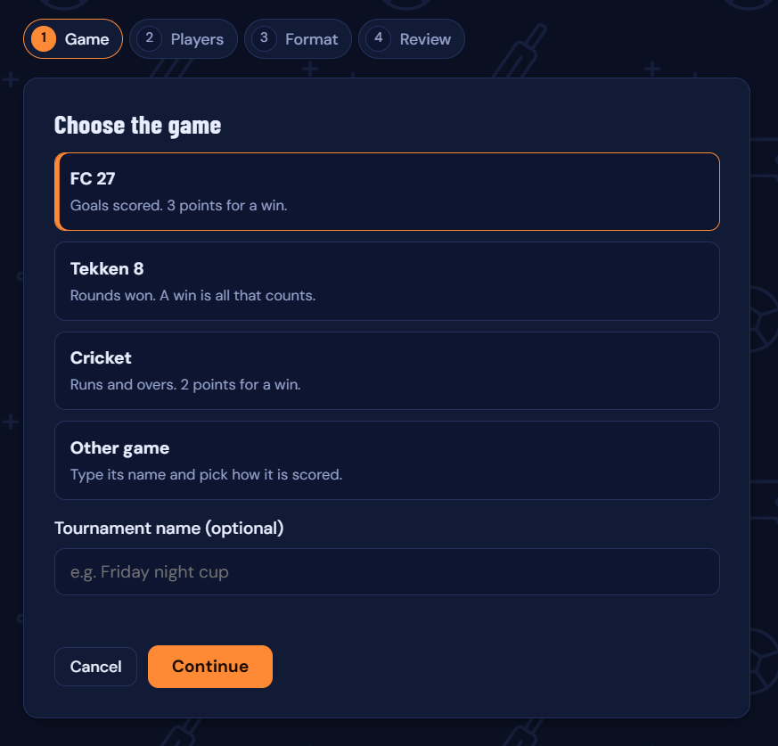
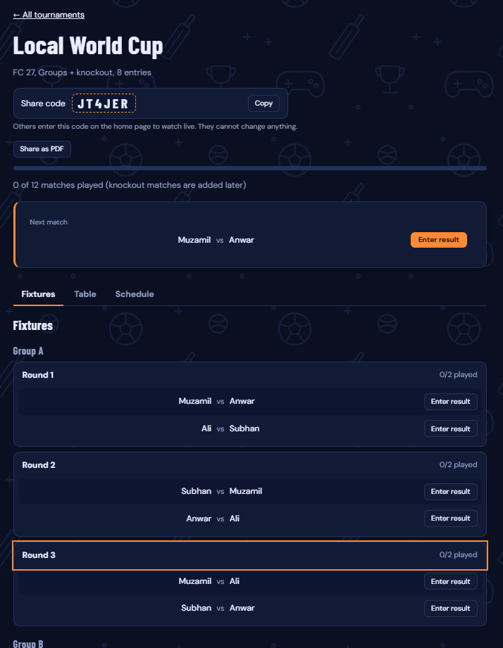
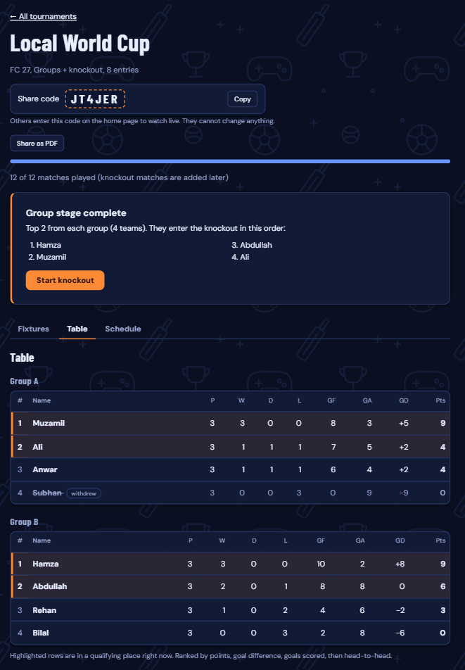
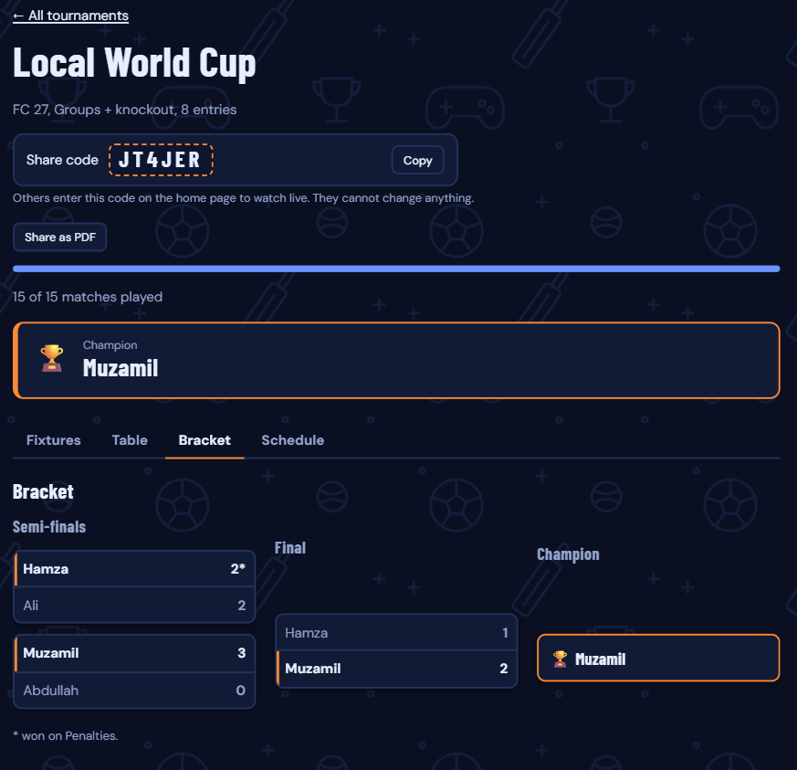
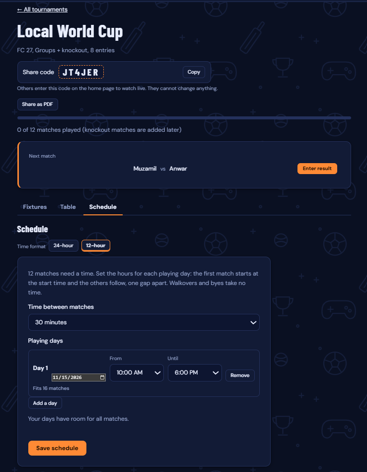
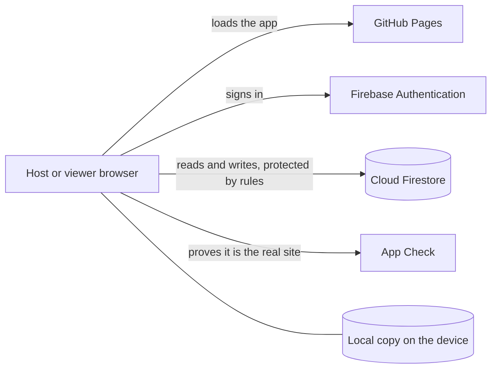

<div align="center">

# Arena — Tournament Manager

**Run FC, Tekken and Cricket tournaments from your phone.**<br>
Fixtures, live tables, brackets and match schedules — with a share code so everyone can follow along in real time.


### [Open the live app →](https://iambakar.github.io/Arena-App/)

</div>

---

## Screenshots

| Home | Setup wizard | Fixtures |
|---|---|---|
|  |  |  |

| Table | Bracket | Schedule |
|---|---|---|
|  |  |  |

---

## Why Arena

Organising a tournament usually means a spreadsheet, a group chat and a lot of arguing about who plays next. Arena replaces that.

- **Any number of entries.** 7, 11, 12, 16 or 64 — byes, uneven groups and qualifiers are handled for you.
- **Rules that match the game.** Football goals, Tekken rounds, cricket runs, overs and Net Run Rate, each with its own points and tie-breakers.
- **Everyone follows live.** Share a six-character code; viewers see fixtures, tables and the bracket update as you enter results.
- **Real tournaments are messy.** Edit results, award walkovers, withdraw players, delay matches and spread play across several days.
- **Works like an app.** Install it on your home screen, use it in light or dark mode, and share a PDF to the group chat.

---

## Contents

[Quick start](#quick-start) · [Features](#features) · [How tournaments work](#how-tournaments-work) · [Sharing and live viewing](#sharing-and-live-viewing) · [Scheduling](#scheduling) · [Walkovers and withdrawals](#walkovers-and-withdrawals) · [PDF export](#pdf-export) · [Cloud saving](#cloud-saving-sync-and-offline-behaviour) · [Install](#install-as-an-app) · [Security and privacy](#security-and-privacy) · [Architecture](#architecture) · [Project structure](#project-structure) · [Data model](#data-model) · [Testing](#testing) · [Browser support](#browser-support) · [Limitations](#known-limitations) · [Roadmap](#roadmap) · [Troubleshooting](#troubleshooting) · [Feedback](#feedback-and-support) · [Licence](#disclaimer-acknowledgements-and-licence)

---

## Quick start

### Host a tournament
1. **Sign up** with an email, a username and an icon, then **verify your email**.
2. Tap **New tournament**, choose the game, paste in your players or teams (one per line) and pick a format.
3. Review the summary and tap **Start tournament**. Arena builds every fixture.
4. Open the **Schedule** tab if you want match times, then enter each result as matches finish.
5. Give the **share code** on your tournament page to anyone who wants to watch.

### Watch a tournament
1. Sign up and verify your email.
2. Enter the host's six-character code in the **Watch a tournament** box on the home page.
3. You now follow it live. It stays in your **Following** list, so you never retype the code.

---

## Features

| Area | What you get |
|---|---|
| **Formats** | League (1x, 2x or 3x meetings, optional playoffs) · Knockout with automatic byes · Groups + knockout with best runners-up |
| **Games** | FC 27 · Tekken 8 · Cricket · Any other game you name, scored like football, cricket or a fighting game |
| **Knockout extras** | Two-legged semi-finals · Third-place match · Penalty, super-over or decider-game winners |
| **Results** | Game-specific entry · Edit or clear any result · Warnings before changes alter later matches |
| **Standings** | Live tables with qualification highlighting · Net Run Rate · Head-to-head tie-breaks |
| **Bracket** | Visual bracket with winners, byes, aggregates and a champion banner |
| **Scheduling** | Gap-based match times · Multi-day play · Delays that move every later match · 24-hour or 12-hour display |
| **Disruptions** | Walkovers · Player withdrawals and reinstatement |
| **Sharing** | Six-character share codes · Read-only live viewing · Following list |
| **Accounts** | Email sign-up · Verified emails · Unique usernames · Password reset · Show/hide password |
| **Sync** | Cloud saving across devices · Conflict protection · Offline recovery · Save-status badge · Connection check |
| **Export** | PDF of standings, knockout, fixtures and times · Phone share sheet |
| **App** | Installable on iPhone, Android and desktop · Light, dark or automatic theme · Responsive design |
| **Support** | In-app feedback and problem reports |

---

## How tournaments work

### Games and scoring

| Game | How a result is entered | Default points | Tie-break order |
|---|---|---|---|
| **FC 27** (football) | Goals for each side | Win 3, draw 1, loss 0 | Points, goal difference, goals scored, head-to-head |
| **Tekken 8** | Rounds won by each side (no draws) | Win only | Wins, round difference, rounds won, head-to-head |
| **Cricket** | Winner, runs, overs and an all-out flag; tie or no result allowed in group games | Win 2, tie or no result 1, loss 0 | Points, wins, **Net Run Rate**, head-to-head |
| **Other game** | Name it and choose football, cricket or fighting-game scoring | As the chosen type | As the chosen type |

- Points are editable for each tournament, and cricket has configurable overs per innings.
- **Net Run Rate** uses runs and overs (`12.3` means 12 overs and 3 balls). A team that is all out is treated as having faced its full overs, and no-result matches do not affect it.
- A knockout tie that finishes level asks who won the **penalties, super over or decider game**. Two-legged ties use the aggregate score.
- When teams are level on every table measure, the final tie-breaker is **head-to-head points** between them.

### Fixtures
Round-robin fixtures use the **circle method**: everyone plays everyone once per cycle, and an odd number of entries gets a rest round rather than a bye match. Repeated cycles alternate home and away. Each round shows who is resting.

### Knockouts with any number of entries
The bracket is rounded up to the next power of two. The spare places become **byes**, given to the top seeds, with standard seeding so the strongest entries meet late. Seeding is either a random draw or the order you entered.

### Groups and qualifiers
- Entries are split into groups with a snake distribution, so sizes differ by at most one (11 entries in 3 groups become 4, 4 and 3).
- Each group needs at least three entries, and the group format needs at least six entries in total.
- The number advancing is always a **power of two**, so the knockout is clean. Arena only offers valid choices, and at least one team per group is always knocked out. For example:
  - 2 groups: top 1 (a final) or top 2 (semi-finals)
  - 3 groups: top 1 from each plus the best runners-up
  - A single league: top 2, 4 or 8 to a playoff, or simply crown the table leader
- **Best runners-up** are compared across groups of different sizes by points per game.

### Running the stages
- The current round opens automatically, and a **Next match** card points to what is next.
- When a group stage or league finishes, a panel shows the qualifiers in seed order with a **Start knockout** button.
- Group results **lock** once the knockout starts. **Reopen the group stage** undoes this.
- Changing a knockout result that affects later matches **asks you first**, because the affected later results are cleared.
- The tournament ends with a **Champion** banner and moves to **History**.

---

## Sharing and live viewing

1. A host's tournament is saved to their account and shows a **share code** with a **Copy** button.
2. A viewer enters the code and sees a **live, read-only** copy: fixtures, table, bracket and schedule update without refreshing.
3. The tournament is added to the viewer's **Following** list and can be unfollowed at any time. If the host deletes it, viewers see a "not found" page with a button to remove it from their list.

Codes avoid look-alike characters (no `0`, `O`, `1` or `I`). Only the host can change a tournament, and this is enforced by server-side rules rather than just the interface.

---

## Scheduling

Set times once instead of typing one for every match.

| Setting | Detail |
|---|---|
| **Gap between matches** | 10, 15, 20, 30, 45 or 60 minutes |
| **Playing days** | One row per day with a date, start time and end time. Days can be non-consecutive and each can have different hours |
| **Capacity** | Each day shows how many matches fit. If you run out of room, extra days are added using the last day's hours |
| **Order** | Group or league rounds first, then knockout rounds, with the third-place match before the final |
| **Excluded** | Byes and walkovers take no time slot |
| **Delays** | Add or remove minutes on any upcoming match. It and every later match **on the same day** move together. A delay never carries into the next day, but can push late matches onto it |
| **Display** | 24-hour or 12-hour, saved per device. Viewers see the live, shifted times |

Times are **planned start times**. Arena does not track when a match actually begins, so after a late start the host adds a delay.

---

## Walkovers and withdrawals

- **Walkover:** recorded as 3–0 in FC and 2–0 in Tekken. In cricket the points are awarded without affecting Net Run Rate. In a knockout the winner advances, and for a two-legged tie the walkover decides the whole tie.
- **Withdraw a player** (host only, from the **Players** section): matches already played stand, their remaining matches go to their opponents, and they can no longer qualify or win. In a knockout the opponent advances at once, or as soon as it is known.
- **Reinstate** removes only the walkovers given automatically because of the withdrawal. It asks first, and can also clear knockout results that followed. It is unavailable once a group stage is locked.

---

## PDF export

**Share as PDF** creates a document inside the browser, with no outside service and no internet needed. It contains the tournament header, the champion, standings for each group, the knockout rounds, and every fixture with its result and scheduled time. On phones it opens the **share sheet** (WhatsApp and others); on computers a box offers **Download** or **Open in new tab**.

The PDF uses a built-in Latin font, so names in other scripts (for example Urdu) show as `?`.

---

## Cloud saving, sync and offline behaviour

- Tournaments live in **Cloud Firestore** under the host's account and are mirrored on the device, so they open on any device you log in on.
- Every save is **versioned**. If the same tournament was changed on another device first, Arena keeps the newer cloud copy and tells you, rather than silently overwriting it.
- Changes made while **offline** stay on the device and upload when the connection returns.
- One problem tournament never blocks the others, and the **save-status badge** (Saving, Saved, Not saved, Offline) says exactly what failed and why.
- Tournaments created before accounts existed are **moved into the account automatically** at first login.
- **Check cloud connection** in the profile menu tests your login, email verification, read access and a real write.

---

## Install as an app

- **iPhone:** open the link in **Safari**, tap **Share**, then **Add to Home Screen**.
- **Android:** open in **Chrome**, then **menu → Install app**, or use the button in the profile menu.
- **Desktop:** use the install icon in the address bar of Chrome or Edge.

After the first visit the app shell loads offline; cloud features need a connection. A service worker checks the server on every load, so updates never mix old and new files. On iPhone the installed app and Safari keep separate login sessions.

---

## Security and privacy

### What protects the data
- **Server-side security rules** (`firestore.rules`) decide who can read and write. Only the host can create, change or delete a tournament; viewers can only read.
- A **verified email** is required for every tournament, follow and feedback action.
- **Usernames are reserved only after verification**, which stops throwaway accounts from squatting names.
- **Versioned writes:** a tournament can only be updated if its revision is exactly one higher than the stored one.
- **Input is escaped** before display, so names cannot inject markup.
- **Firebase App Check** with reCAPTCHA Enterprise confirms that requests come from the real site.
- **No secrets are stored in this repository.** The Firebase web configuration identifies the project and is public by design; protection comes from the rules and App Check.

### What is stored
| Data | Where | Who can see it |
|---|---|---|
| Email address and password (hashed) | Firebase Authentication | Only the project owner, in the console |
| Username and icon | `users`, `usernames` | The person; usernames can be checked one at a time at sign-up |
| Tournaments, entry names, results, schedule | `tournaments` | The host; anyone with the share code and a verified account can view |
| Tournaments you follow | `users/{uid}/following` | You |
| Feedback you send | `feedback` | Only the project owner, in the console |
| Anonymous usage analytics | Firebase Analytics | Only the project owner |

Usage analytics records anonymous events: `sign_up`, `login`, `create_tournament`, `join_tournament` and `send_feedback`.

There is no account-deletion button yet. To have an account and its data removed, send a request through [GitHub issues](https://github.com/iambakar/Arena-App/issues) or the in-app feedback form, and the owner will delete it.

---

## Architecture

Arena is a **static front end** — plain HTML, CSS and JavaScript with no build step — that talks directly to **Firebase**.



| Layer | Technology |
|---|---|
| Interface | HTML, CSS (custom properties, grid) and vanilla JavaScript |
| Tournament logic | Dependency-free JavaScript modules that run in the browser and in Node |
| Hosting | GitHub Pages |
| Accounts | Firebase Authentication (email and password, email verification) |
| Database and live updates | Cloud Firestore with real-time listeners |
| Abuse protection | Firebase App Check (reCAPTCHA Enterprise) |
| Offline and install | Web app manifest and a service worker |
| PDF | A small in-house PDF writer using the built-in Helvetica fonts |
| Fonts | Barlow Condensed and DM Sans |

The tournament rules are kept apart from the interface (`core.js`, `engine.js`, `schedule.js`) so they can be tested on their own.

---

## Project structure

```
/
├─ index.html              App shell
├─ style.css               Design system, themes, layout
├─ app.js                  Routing, account state, home page, profile menu, feedback, install
├─ auth.js                 Log in, sign up, verify email and reset password screens
├─ setup.js                New-tournament wizard (game, players, format, review)
├─ tournament.js           Tournament page: fixtures, results, tables, bracket, schedule, players
├─ watch.js                Read-only live page opened with a share code
├─ core.js                 Fixtures, groups, qualifiers, brackets, standings, Net Run Rate
├─ engine.js               Result validation, knockout progression, walkovers, withdrawals
├─ schedule.js             Match times, multi-day layout, delays
├─ exporter.js             PDF builder and sharing
├─ store.js                Local storage layer and settings
├─ sync.js                 Local-to-cloud synchronisation and save status
├─ cloud.js                Firebase: auth, profiles, tournaments, following, feedback, App Check, analytics
├─ firebase-config.js      Firebase project settings and App Check site key
├─ firestore.rules         Security rules
├─ sw.js                   Service worker (offline support, fresh updates)
├─ manifest.webmanifest    Install metadata
├─ icons/                  App icons (rounded, maskable and iPhone)
├─ docs/screenshots/       README images
├─ tests.js                Logic test suite for Node
├─ demo.html               Browser demo of the core logic
├─ LICENSE                 MIT licence
└─ README.md
```

---

## Data model

**`tournaments/{code}`** — the document id is the share code.

| Field | Meaning |
|---|---|
| `ownerId`, `ownerName` | The host's account id and username |
| `name`, `game`, `sport`, `format` | Display name, game label, scoring type (`football`, `cricket`, `tekken`) and format (`league`, `knockout`, `groups`) |
| `status`, `championName` | `running` or `finished`, and the winner |
| `createdAt`, `updatedAt`, `rev` | Creation time, server timestamp and revision number |
| `data` | The whole tournament as a JSON string: entries, groups, fixtures, results, knockout, withdrawals and schedule |

The tournament is stored as one JSON string because Firestore does not allow nested arrays, and a whole tournament stays far below the 1 MiB document limit (a 16-entry league with three meetings is about 36 KB).

Other collections: `users/{uid}`, `usernames/{name}`, `users/{uid}/following/{code}` and `feedback/{id}`.

---

## Testing

The rules engine can be tested without a browser:

```bash
node tests.js
```

The suite covers round-robin pairing, group splitting, qualifier options, byes for 3 to 16 entries in all three games, two-legged ties, edit and undo behaviour, standings and tie-breakers, Net Run Rate, and a full run from groups to a champion. `demo.html` runs the same logic visibly in a browser.

During development, scripted scenarios also verified the interface, scheduling and delays, walkovers and withdrawals, read-only viewing, conflict handling and offline recovery.

---

## Browser support

Current versions of Chrome, Edge, Firefox and Safari, roughly from 2023 onward. Arena uses ES modules, the `<dialog>` element, CSS `color-mix()` and CSS masks, so older phones may show an unstyled page or fail to open dialogs. Some ad blockers and privacy tools can block the reCAPTCHA check; if the app says the cloud refused a request, try turning them off for the site. In-app browsers opened from social apps can also handle reCAPTCHA differently, so opening the link in your main browser is the most reliable.

---

## Known limitations

- **Free-tier quotas.** Firebase's free plan has daily read limits, so very large audiences watching many live tournaments at once could reach them.
- **One host per tournament.** Only the host can enter results.
- **No player profiles or career stats.** Entries are names, not accounts.
- **Planned times only.** Match times are a plan; delays are added by the host.
- **Back-to-back matches** are possible because round order is fixed rather than rest-optimised.
- **PDF font.** The PDF supports Latin characters only.
- **No account-deletion button** and **no automatic database backups** on the free plan.
- **Wizard limits.** Up to 64 entries, and the number of players cannot change after a tournament starts (use withdrawals).

---

## Roadmap

- Join by link and QR code
- Co-scorers who can enter results
- Big-screen mode for TVs and projectors
- Stations or consoles and a "who plays next" queue
- Double elimination, best-of-N matches and Swiss rounds
- Player profiles and career statistics
- "My matches" highlighting for viewers
- Rest-aware scheduling to avoid back-to-back matches
- Unicode PDF support
- Result history showing who changed what, and when
- Privacy controls, including analytics consent

---

## Troubleshooting

| Problem | What to do |
|---|---|
| The badge says **Not saved** | Tap it to see the reason, then open the profile menu and run **Check cloud connection** |
| "The cloud refused this" | Confirm your email is verified, then reload. Ad blockers can also cause this |
| A red bar lists old files | Some files did not update together. Reload with `Ctrl+Shift+R`, or clear the site's data |
| Verification email not arriving | Check your spam folder, then use **Send again** on the verify screen |
| The app looks out of date | Close and reopen it, or reload the page |
| Cannot install on iPhone | Open the link in **Safari**, not an in-app browser, then use **Share → Add to Home Screen** |

---

## Feedback and support

Signed-in users can open the profile menu, or use the link at the bottom of the page, and choose **Send feedback** to report a problem or suggest an idea. Messages can optionally include technical details (page, browser, app version and save status) and are readable only by the project owner.

You can also [open an issue](https://github.com/iambakar/Arena-App/issues).

---

## Disclaimer, acknowledgements and licence

**Disclaimer.** Arena is an independent project and is not affiliated with, endorsed by or sponsored by EA Sports, Bandai Namco or any game publisher. FC, Tekken and other names are trademarks of their owners and are used only to describe the kinds of games the app can organise.

**Acknowledgements.** Built with Firebase. Fonts are Barlow Condensed and DM Sans from Google Fonts, used under the SIL Open Font License. Developed iteratively with AI assistance from Claude (Anthropic).

**Licence.** Released under the [MIT License](LICENSE). Copyright © 2026 Abu Bakar.
